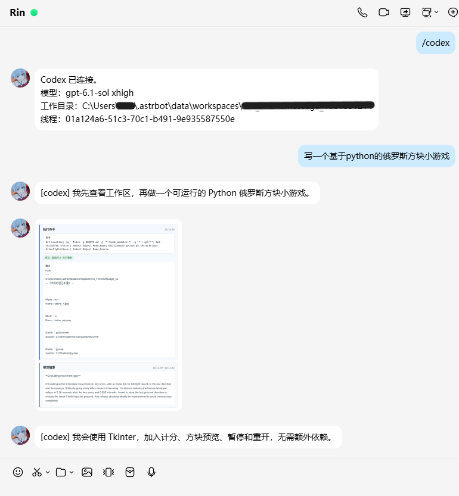
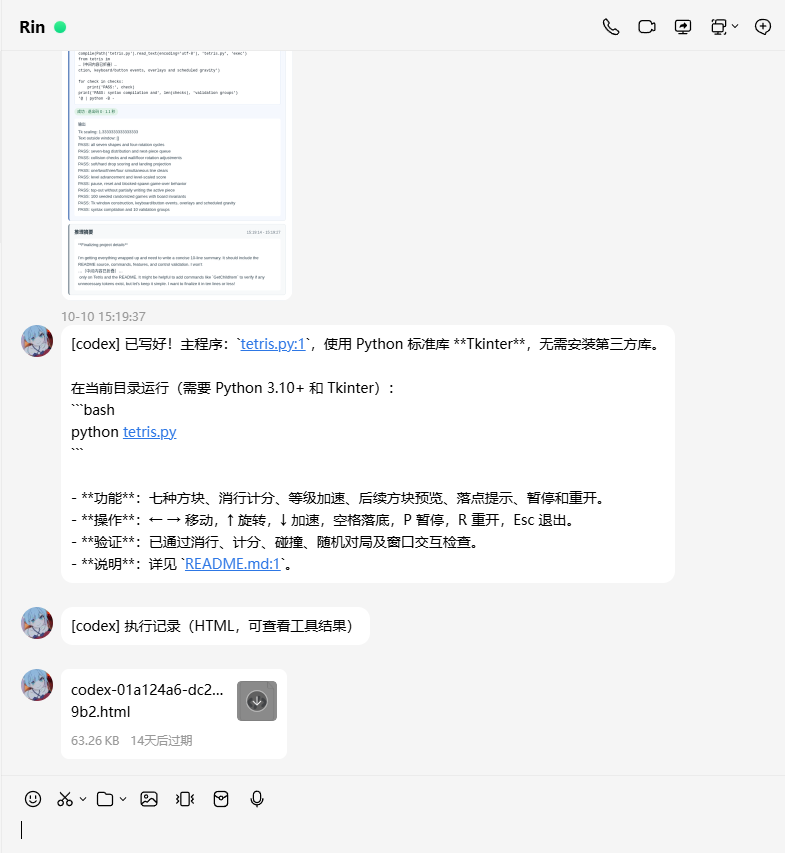
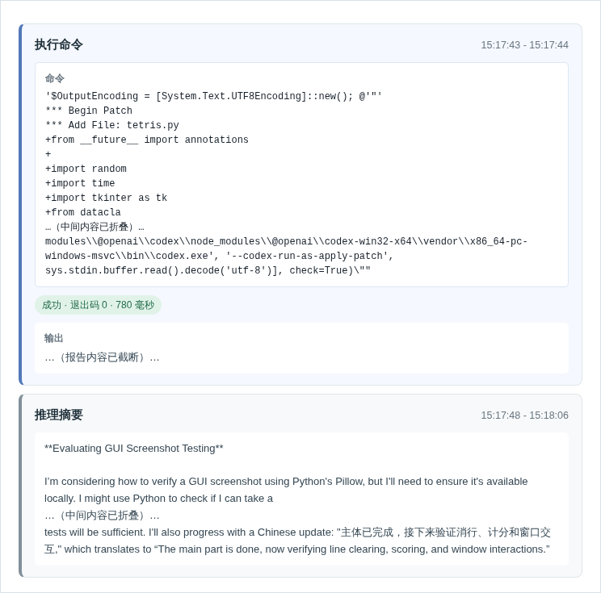
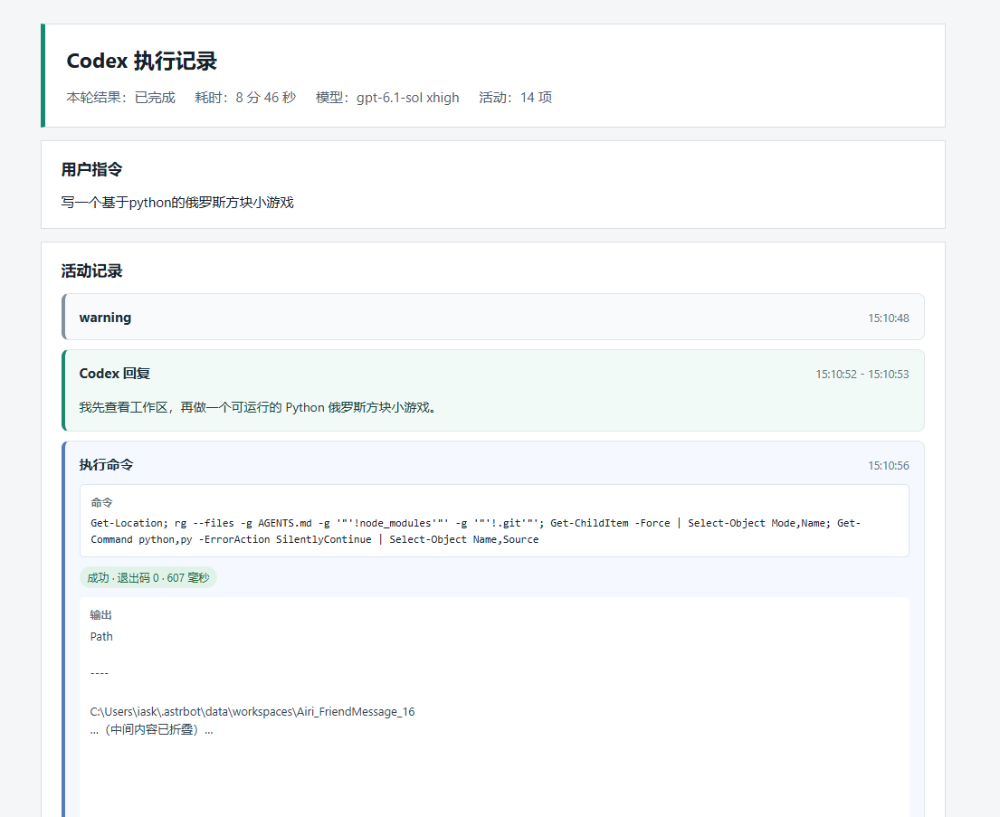

# AstrBot Codex app-server

通过 Codex CLI 的 `app-server` JSON-RPC，在 AstrBot 中使用 Codex。插件会为每个 AstrBot 会话维护独立的 Codex 线程，并使用该会话对应的工作目录。

## 功能概览

- **Codex 直连**：通过 `app-server` 直接连接 Codex CLI，在 AstrBot 中下达任务并接收回复，默认使用本地 `.codex/config.toml` 配置。
- **Codex 命令支持**：支持模型与思考等级切换、上下文压缩、代码审查、任务控制和执行审批。
- **过程图片反馈**：可选分批发送执行过程图片，直观展示命令执行、文件变更和工具调用。
- **HTML 执行报告**：可选在任务结束后发送 HTML 报告，集中查看执行记录、工具结果与文件差异。
- **会话连接与切出**：`/codex` 连接或恢复会话，`/codex exit` 切出并保留线程，重新连接即可接续对话。

## 效果展示

| 示例 | 图片 |
| --- | :---: |
| **示例一** | [](example/example1.png) |
| **示例二** | [](example/example2.png) |
| **执行过程** | [](example/example_process.png) |
| **HTML 执行报告部分截图** | [](example/example_report.png) |

## 命令

所有命令都以 `/codex` 开头：

| 命令                               | 作用                                                         |
| ---------------------------------- | ------------------------------------------------------------ |
| `/codex`                           | 连接 Codex；已有绑定时恢复原线程。                           |
| `/codex help`                      | 显示命令帮助。                                               |
| `/codex status`                    | 查看连接状态、任务状态、当前活动、模型、工作目录和线程 ID。  |
| `/codex pwd`                       | 查看当前线程的工作目录。                                     |
| `/codex new`                       | 在当前工作目录创建并切换到新的 Codex 线程。                  |
| `/codex stop`                      | 中断当前正在运行的任务。                                     |
| `/codex exit`                      | 断开当前聊天的连接，但保留线程绑定和工作目录。               |
| `/codex close`                     | 删除当前聊天的线程绑定并中断任务；Codex 中保存的线程历史不会被删除。 |
| `/codex compact`                   | 请求 Codex 压缩当前线程上下文。                              |
| `/codex review`                    | 审查未提交的改动。                                           |
| `/codex review base <分支>`        | 对比指定基础分支并进行代码审查。                             |
| `/codex review commit <SHA>`       | 审查指定提交。                                               |
| `/codex model`                     | 列出当前 Codex 可用模型及其思考等级。                        |
| `/codex model <模型ID> [思考等级]` | 切换当前线程的模型，可同时设置思考等级。                     |
| `/codex effort`                    | 查看当前模型支持的思考等级和当前设置。                       |
| `/codex effort <思考等级>`         | 切换当前线程的思考等级。                                     |
| `/codex yes`                       | 批准待处理的命令执行或文件修改请求。                         |
| `/codex no`                        | 拒绝待处理的命令执行或文件修改请求。                         |
| `//开头的文本`                     | 去掉一个 `/` 后作为普通 Codex 任务发送，例如 `//review this file`。 |

任务执行期间，普通文本会继续发送给当前线程；如果已有任务正在运行，新消息会作为对当前任务的追加指令发送。

## 前置条件

- AstrBot `>=4.27,<5`。
- 已安装并完成登录的 Codex CLI。
- AstrBot 运行环境可以执行 `codex app-server --listen stdio://`。
- Codex 对会话工作目录具有所需的读写权限。

先在运行 AstrBot 的同一环境中确认 Codex CLI 可用：

```text
codex --version
codex login
```

如果 `codex` 不在 `PATH` 中，可以在插件配置的 `codex_command` 中填写 `codex.cmd` 或 Codex 可执行文件的绝对路径。

## 安装与开始使用

1. 将本插件目录放入 AstrBot 的插件目录，或使用 AstrBot 支持的插件安装方式安装。
2. 在 AstrBot 中启用插件；首次启用前按需修改插件配置。
3. 使用 AstrBot 管理员账号发送 `/codex`。
4. 连接成功后，直接发送普通文本即可交给 Codex 处理。

最小使用示例：

```text
/codex
请检查当前项目的测试，并修复失败项。
/codex status
```

插件重启后不会自动启动 Codex 连接。若会话显示为“未连接”，重新发送 `/codex` 即可恢复已保存的线程。

## 配置

插件只接受下表中的配置项；未知配置会直接报错，不会静默忽略。

| 配置项 | 类型 | 默认值 | 说明 |
| --- | --- | --- | --- |
| `codex_command` | 字符串 | `codex` | Codex CLI 命令名或可执行文件路径。Windows 环境可填写 `codex.cmd` 或绝对路径。 |
| `approval_timeout` | 整数 | `180` | 等待 `/codex yes` 或 `/codex no` 的秒数，范围为 `30`～`900`。超时后自动拒绝。 |
| `send_progress_images` | 布尔值 | `false` | 是否在执行过程中发送 HTML 渲染的活动图片。每累计 3 条主要活动发送一张，任务结束时发送剩余活动。 |
| `send_final_report` | 布尔值 | `false` | 是否在任务结束时发送 HTML 执行报告。包含工具操作的任务或失败任务会生成报告。 |
| `allow_group_chat` | 布尔值 | `false` | 是否允许 AstrBot 管理员在群聊中连接 Codex。关闭时不允许群聊使用。 |
| `reply_prefix_mode` | 字符串 | `codex` | 连接状态下的消息前缀：`codex` 使用 `[codex]`，`model` 使用当前模型名（例如 `[gpt-6.1-sol]`），`none` 不添加前缀。模型信息不可用时，`model` 模式显示 `[未知]`。 |

### 配置示例

```json
{
  "codex_command": "codex",
  "approval_timeout": 180,
  "send_progress_images": false,
  "send_final_report": true,
  "allow_group_chat": false,
  "reply_prefix_mode": "codex"
}
```

## 会话、权限与工作目录

- 仅 AstrBot 管理员可以使用插件。私聊默认可用，群聊还必须开启 `allow_group_chat`。
- 私聊按 AstrBot 的会话来源分别绑定 Codex 线程；群聊按“平台 + 群 ID”绑定。
- 工作目录由 AstrBot 当前会话工作区解析，并在连接或新建线程时传给 Codex。
- 同一群的不同管理员共享该群的 Codex 线程、工作目录、任务和审批状态；普通群成员的消息不会发送给 Codex。
- `/codex exit` 只断开连接，之后仍可用 `/codex` 恢复；`/codex close` 才会解除线程绑定。
- 关闭或重启插件时，运行中的 Codex 任务会停止，`app-server` 连接会关闭；已保存的线程绑定会保留，但需要重新发送 `/codex` 连接。

## 执行反馈与报告

### 文本回复

Codex 生成回复时，插件会按完成的消息直接发送，不必等整轮任务完全结束。使用 `/codex status` 可以查看当前任务、运行时间、活动和线程信息。

连接状态下的消息前缀由 `reply_prefix_mode` 控制。可选值为 `codex`（默认，显示 `[codex]`）、`model`（显示当前线程模型名）和 `none`（不添加前缀）。模型信息暂不可用时，`model` 模式显示 `[未知]`。

### 执行过程图片

开启 `send_progress_images` 后，插件会将命令执行、文件变更、工具调用、审批等主要活动渲染为图片发送。图片只包含活动卡片，不包含用户指令和 Codex 文本回复；较长的命令或结果会显示首尾节选。

### HTML 执行报告

开启 `send_final_report` 后，含工具操作的任务、失败任务和涉及审批的任务会在结束时附上 HTML 报告；纯文本对话只发送 Codex 回复。报告通常包括：

- 用户指令、任务状态和工具活动；
- 命令输出、文件变更、执行计划、推理摘要和审批结果；
- 长文本的首尾节选，以及可展开查看的保留内容。

报告文件会保存到插件数据目录并作为文件发送。为控制消息和文件体积，过长的用户指令、命令输出或工具结果会被截断，报告会标明截断情况。执行记录不依赖 `astrbot_plugin_browser`。

## 审批与安全边界

- Codex 的 `approval_policy` 和 `sandbox_mode` 由 Codex 自身配置决定，插件不会覆盖 `~/.codex/config.toml` 中的设置。
- 当 Codex 请求执行命令或修改文件时，插件会在对应聊天中提示；回复 `/codex yes` 批准，回复 `/codex no` 拒绝。
- 审批超过 `approval_timeout` 未处理会自动拒绝。插件不会自动授予额外权限。
- Codex 的额外权限请求目前会被拒绝；TUI 专属斜杠命令不会逐项模拟，只支持本 README 列出的插件命令。
